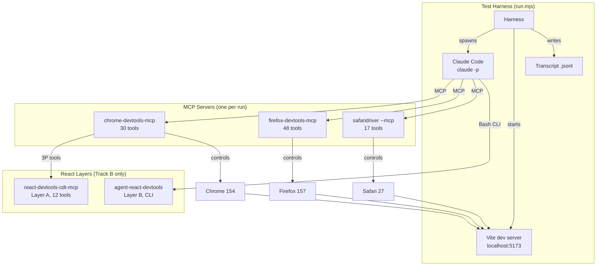
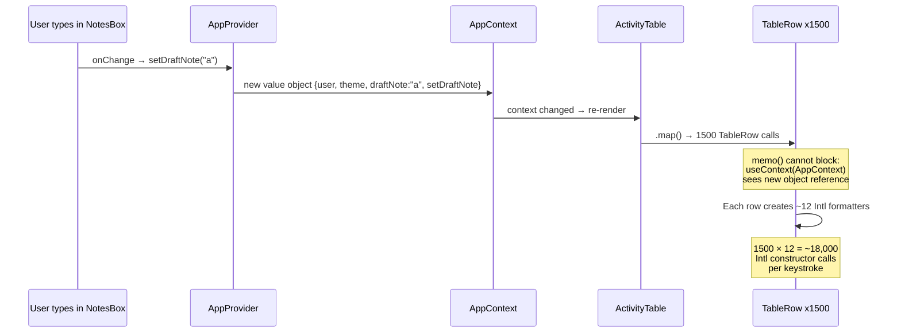
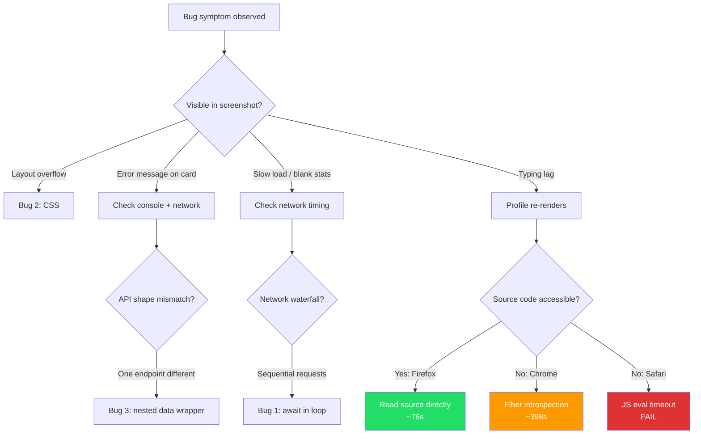

# Field log: Chrome vs Safari vs Firefox debugging MCPs

## 1. Environment

- **Machine:** Apple M4, 16 GB RAM
- **OS:** macOS 26.6.2 (Build 25G83)
- **Safari:** 27.0 (21625.1.29.18.28) -- upgraded from 26.6.2 during Phase 0. `safaridriver --mcp` works.
- **Chrome:** 154.0.8037.98
- **Firefox:** 157.0
- **Node:** v22.14.0
- **npm:** 10.9.2
- **Claude Code:** 2.1.97
- **Model:** claude-opus-4-6 (confirmed from all transcript system/init events)
- **`~/.claude/CLAUDE.md`:** does not exist

### Pinned package versions

| Package | Pinned version |
| --- | --- |
| `chrome-devtools-mcp` | 1.10.1 |
| `@mozilla/firefox-devtools-mcp` | 0.10.4 |
| `react-devtools-cdt-mcp` | 0.1.0 |
| `agent-react-devtools` | 0.5.0 |

### Safari --mcp check

- Command: `safaridriver --mcp`
- Result: FAIL
- Exact output: `safaridriver: unrecognized option '--mcp'`
- safaridriver help lists these flags only: `--help`, `--version`, `--port`, `--bidi`, `--enable`, `--diagnose`
- Safari 27 is required for MCP support. This machine has Safari 26.6.2.
- The Safari MCP track cannot run unless the human upgrades to Safari 27 or later.

## 2. Running log

### [Phase 0] Environment collection
- Command: `sw_vers`, `node --version`, `npm --version`, `claude --version`, browser version checks, `npm view <pkg> version`
- Result: PASS
- All versions collected. See section 1.

### [Phase 0] safaridriver --mcp test
- Command: `safaridriver --mcp`
- Result: FAIL
- Exact output: `safaridriver: unrecognized option '--mcp'`
- What I changed next: Logged the failure. Safari track blocked until Safari 27+ is installed.

### [Phase 0] Doc check
- Fetched READMEs for all 5 tools via WebFetch.
- Result: PASS for Chrome, Firefox, React layer A, React layer B. Safari docs fetched from Apple .md URL.
- Key differences from prompt claims:
  - React layer A has 12 tools, not 10. Extra: `react_get_component_by_dom_element`, `react_get_parent_stack`.
  - `--categoryExperimentalThirdParty` is documented in the react-devtools-cdt-mcp README, not the Chrome MCP README.
  - Safari requires Safari 27+. We have 26.6.2. BLOCKER.
  - Firefox `basic` preset (default) lacks network/console/profiler. Confirmed. Must use `developer`.
- `gh` CLI is not installed on this machine. Used WebFetch for all doc fetches.

### [Phase 1] App built
- Stack: Vite 8.3.2, React 19.3.0, TypeScript 6.0.2
- React Compiler OFF, StrictMode OFF
- Mock API: Vite middleware plugin with fixed delays (350 ms stats, 80 ms others)
- All 4 bugs planted and verified via API:
  - Bug 1: sequential stats take ~3160 ms (confirmed)
  - Bug 2: long project name with nowrap + no min-width:0 on flex item
  - Bug 3: project 5 returns `{data:{...}}` instead of `{revenue,...}` (confirmed)
  - Bug 4: context provider creates new value object on every render, 300 memo'd rows re-render
- Three run modes: `npm run dev`, `npm run dev:cdt`, `npm run dev:ard`
- Installed: react-devtools-cdt-mcp@0.1.0, agent-react-devtools@0.5.0
- No debug globals, no bug-hinting names, no comments naming bugs

### [Phase 0] Safari upgrade
- Command: `softwareupdate --install "Safari27.0TahoeAuto-27.0"`
- Result: PASS
- Safari upgraded from 26.6.2 to 27.0 (21625.1.29.18.28). No restart needed.
- `safaridriver --mcp` now works. Clean exit code 0, no error output.

## 3. Setup notes per tool

### Safari (safaridriver --mcp, Safari 27.0)
- Initially Safari 26.6.2. `safaridriver --mcp` returned `unrecognized option '--mcp'`.
- Upgraded to Safari 27.0 via `softwareupdate --install "Safari27.0TahoeAuto-27.0"` (standalone, no restart).
- `/usr/bin/safaridriver --mcp` now works. Clean exit, no errors.
- Config: `{ "command": "/usr/bin/safaridriver", "args": ["--mcp"] }`
- First action in a session must be a navigation. Other actions before that may return an error.
- 17 tools exposed (from Apple docs): browser_console_messages, browser_dialogs, close_tab, create_tab, evaluate_javascript, get_network_request, get_page_content, list_network_requests, list_tabs, navigate_to_url, page_info, page_interactions, screenshot, set_emulated_media, set_viewport_size, switch_tab, wait_for_navigation.

### Chrome (chrome-devtools-mcp 1.10.1)
- Start: `npx -y chrome-devtools-mcp@1.10.1`
- Flags used: `--isolated`, `--no-usage-statistics`, `--no-performance-crux`
- For React layer A: add `--categoryExperimentalThirdParty=true`
- Chrome requirement: current stable or newer (we have 154.0.8037.98)
- Default is headed mode. `--headless` is an option but we run headed.
- Full tool list not in README. References docs/tool-reference.md. Will get actual list from smoke test.
- Docs also mention: `--slim`, `--no-update-checks`

### Firefox (@mozilla/firefox-devtools-mcp 0.10.4)
- Start: `npx @mozilla/firefox-devtools-mcp@0.10.4`
- Flags used: `--tool-preset developer --viewport 1280x720`
- Presets (cumulative): slim (pages, snapshot, input, screenshot) < basic (default, adds downloads, script, utilities, management, webextension, screencast) < developer (adds debugging, network, console, profiler) < mozilla (adds launch, prefs, privileged) < all
- The `basic` default has NO network, console, or profiler. Must use `developer` for scored runs.
- Firefox requirement: 100+ (we have 157.0). Node 20.19.0+ (we have 22.14.0).
- Other flags: `--firefox-path`, `--profile-path`, `--start-url`, `--accept-insecure-certs`, `--connect-existing`, `--marionette-port`, `--pref`, `--log-file`, `--unrestricted-save-paths`

### React layer A (react-devtools-cdt-mcp 0.1.0)
- Install: `npm install react-devtools-cdt-mcp`
- Import line: `import 'react-devtools-cdt-mcp/register';` -- must come BEFORE importing React.
- Chrome-only. Requires chrome-devtools-mcp 1.3.0+ (we have 1.10.1) and `--categoryExperimentalThirdParty=true`.
- Accessed through `list_3p_developer_tools` and `execute_3p_developer_tool` on the Chrome MCP.
- Tools registered (12, not 10 as prompt claimed):
  1. `react_get_component_tree`
  2. `react_get_component_by_uid`
  3. `react_get_component_by_dom_element`
  4. `react_find_components`
  5. `react_get_component_source`
  6. `react_get_owner_stack_trace`
  7. `react_get_parent_stack`
  8. `react_get_owner_stack`
  9. `react_start_profiling`
  10. `react_stop_profiling`
  11. `react_get_trace_overview`
  12. `react_get_commit_report`
- Prompt claimed 10 tools. Docs show 12. Extra: `react_get_component_by_dom_element`, `react_get_parent_stack`.

### React layer B (agent-react-devtools 0.5.0)
- Install: `npm install -g agent-react-devtools` or `npx agent-react-devtools start`
- NOT an MCP server. It is a CLI tool.
- Daemon runs on port 8097 by default. Survives across CLI calls.
- Vite plugin: `import { reactDevtools } from "agent-react-devtools/vite";` in vite.config.ts, placed before `react()`.
- Must use headed mode. Headless Chromium does not properly execute the devtools connect script.
- Agent interacts via shell commands like `agent-react-devtools get tree`, `find`, `profile`.

## 4. Planted bugs

### Stack
- Vite 8.3.2, React 19.3.0, TypeScript 6.0.2
- React Compiler: OFF (could fix bug 4 by itself)
- StrictMode: OFF (doubles effects in dev, would muddy network log)
- Mock API: Vite middleware plugin, fixed 350 ms delay per stats call, 80 ms for other endpoints

### Bug 1: Network waterfall
**File:** `src/components/CardRow.tsx`
**Symptom:** Stats take about 3 seconds to appear after page load.
```typescript
// CardRow.tsx, load function inside useEffect
async function load() {
  const userRes = await fetch('/api/user');
  await userRes.json();
  const projRes = await fetch('/api/projects');
  const projData = await projRes.json();
  setProjects(projData);
  const map = {};
  for (const p of projData) {
    const statsRes = await fetch(`/api/projects/${p.id}/stats`);
    const statsData = await statsRes.json();
    map[p.id] = statsData;
  }
  setStatsMap(map);
}
```
Verified: sequential API calls take ~3160 ms. Parallel would take ~350 ms.

### Bug 2: CSS layout break
**File:** `src/components/ProjectCard.tsx`
**Symptom:** Page scrolls sideways at 1280x720.
```typescript
// ProjectCard.tsx - card container
<div style={{ flex: 1, border: '1px solid #ddd', borderRadius: 8, padding: '1rem', background: '#fff' }}>
  <div style={{ whiteSpace: 'nowrap', fontWeight: 600, fontSize: '1rem' }}>
    {project.name}  // Project 3: "InfrastructureMonitoringDashboardForProductionServices"
  </div>
```
No `min-width: 0` on the flex item. The long name with `white-space: nowrap` prevents shrinking.

### Bug 3: Console error with hidden cause
**Files:** `src/api/server.ts` (response), `src/components/StatDisplay.tsx` (crash)
**Symptom:** One card shows "Something went wrong".
```typescript
// server.ts - project 5 returns a different shape
function makeStatsForProject5() {
  return { data: { revenue: 68000, users: 1850, growth: 4.2, tickets: 22 } };
}
// All other projects return: { revenue, users, growth, tickets }

// StatDisplay.tsx - crashes on undefined
<div>Growth: {stats.growth.toFixed(1)}%</div>
// stats.growth is undefined because stats is { data: { ... } }
```

### Bug 4: Re-render cascade
**Files:** `src/context/AppContext.tsx` (provider), `src/components/ActivityTable.tsx` (consumer), `src/components/NotesBox.tsx` (trigger)
**Symptom:** Typing in the notes box lags.
```typescript
// AppContext.tsx - new value object every render
<AppContext.Provider value={{ user, theme, draftNote, setDraftNote }}>
  {children}
</AppContext.Provider>

// ActivityTable.tsx - memo'd row reads context
const TableRow = memo(function TableRow({ row }) {
  const { theme } = useAppContext();  // context change bypasses memo
  const dateFmt = new Intl.DateTimeFormat(...);  // expensive per render
  const costFmt = new Intl.NumberFormat(...);
  // ...
});
```
1500 rows re-render on every keystroke. `memo` does not block context updates.
Each row creates ~12 Intl formatters (5 locales x currency + date + relative time + collator + percent + 2 number). Bumped from 300 to 1500 rows because M4 handled 300 without visible lag.

## 5. Fixed cost per MCP
| Config | Tools exposed | Input tokens on a one-word prompt | Extra tokens vs no MCP |
| --- | --- | --- | --- |
| No MCP (baseline) | 0 | 5,807 | 0 |
| Chrome | 30 | 13,604 | +7,797 |
| Chrome + React layer A | 32 | 14,001 | +8,194 |
| Firefox (developer preset) | 48 | 14,014 | +8,207 |
| Safari | 17 | 9,653 | +3,846 |

All measured with `--tools "" --strict-mcp-config`. Model: claude-opus-4-6.

Chrome tools (30): click, close_page, drag, emulate, evaluate_script, fill, fill_form, get_console_message, get_css_styles, get_network_request, handle_dialog, hover, lighthouse_audit, list_console_messages, list_network_requests, list_pages, navigate_page, new_page, performance_analyze_insight, performance_start_trace, performance_stop_trace, press_key, resize_page, select_page, take_heapsnapshot, take_screenshot, take_snapshot, type_text, upload_file, wait_for.

Chrome + React adds: list_3p_developer_tools, execute_3p_developer_tool.

Firefox developer preset (48): accept_dialog, clear_downloads, clear_snapshot, click_by_uid, close_firefox_session, close_page, dismiss_dialog, drag_by_uid_to_uid, evaluate_script, fill_by_uid, fill_form_by_uid, get_console_messages, get_console_output, get_firefox_info, get_firefox_output, get_network_request, get_page_text, hover_by_uid, install_extension, list_downloads, list_network_requests, list_pages, navigate_history, navigate_page, new_page, press_key, resolve_uid_to_selector, screencast_start, screencast_stop, screenshot_by_uid, screenshot_page, select_page, set_download_behavior, set_viewport_size, take_snapshot, type_text, uninstall_extension, upload_file_by_uid, and more.

Safari (17): browser_console_messages, browser_dialogs, close_tab, create_tab, evaluate_javascript, get_network_request, get_page_content, list_network_requests, list_tabs, navigate_to_url, page_info, page_interactions, screenshot, set_emulated_media, set_viewport_size, switch_tab, wait_for_navigation.

Note: Firefox developer preset showed 0 tools at init in quick smoke (MCP still connecting) but 48 in the fixed-cost test. The server takes longer to start than Chrome or Safari.

### Smoke real runs (bug 3, one per browser, unscored)
All three correctly diagnosed bug 3 (different API shape for project 5) with high confidence.
- Chrome: 13 turns, 64s, 158k input + 2k output tokens
- Safari: 25 turns, 175s, 311k input + 3k output tokens
- Firefox: 12 turns, 59s, 104k input + 1.4k output tokens

Safari was notably slower (25 turns vs 12-13). Chrome and Firefox both found it quickly.

## 6. Track A results: browser MCP alone

Each cell is one scored run. RUNS_PER_CELL was set to 1; some cells have two runs because earlier runs produced parse errors and were retried with a different random seed. Parse-error runs (no `result` event in the transcript) are marked ERR and excluded from scoring.

| Bug | Browser | Score | Time (s) | Turns | Total tokens | Cost |
| --- | --- | --- | --- | --- | --- | --- |
| 1 | Chrome | 2 | 123 | 19 | 198,960 | $0.34 |
| 1 | Firefox | 2 | 59 | 11 | 176,242 | $0.35 |
| 1 | Safari | 2 | 94 | 16 | 150,637 | $0.23 |
| 1 | Safari | 2 | 122 | 19 | 250,763 | $0.36 |
| 2 | Chrome | 2 | 109 | 14 | 241,542 | $0.30 |
| 2 | Chrome | 2 | 99 | 9 | 154,294 | $0.26 |
| 2 | Firefox | 2 | 55 | 8 | 104,172 | $0.18 |
| 2 | Firefox | 2 | 101 | 16 | 266,499 | $0.33 |
| 2 | Safari | 2 | 86 | 15 | 203,299 | $0.31 |
| 3 | Chrome | 2 | 68 | 14 | 179,945 | $0.21 |
| 3 | Firefox | 2 | 91 | 21 | 269,056 | $0.33 |
| 3 | Firefox | 2 | 42 | 10 | 96,780 | $0.21 |
| 3 | Safari | 2 | 82 | 17 | 243,823 | $0.31 |
| 4 | Chrome | 2 | 398 | 26 | 500,693 | $0.55 |
| 4 | Firefox | 2 | 76 | 13 | 225,095 | $0.34 |
| 4 | Safari | ERR | — | — | — | — |

Parse errors (no result event): trackA-chrome-bug1-r2, trackA-chrome-bug3-r2, trackA-chrome-bug4-r2, trackA-firefox-bug4-r2, trackA-safari-bug3-r2, trackA-safari-bug4-r0.

### Per-cell notes

**Bug 1 (network waterfall):** All three browsers found it. Firefox was fastest (59s, 11 turns) — it used `enable_debugger` + `list_scripts` + `get_script_source` to read the actual `CardRow.tsx` source and quoted the offending `for...of` loop verbatim. Chrome took 123s using `list_network_requests` + repeated `get_network_request` calls to build a timing table, then confirmed with `performance_analyze_insight`. Safari needed a page reload to populate the network buffer (it does not retain pre-session network traffic), adding overhead.

**Bug 2 (CSS layout break):** The easiest bug. Firefox solved it in 55s / 8 turns — the fastest single run in the entire benchmark. Chrome also solved it quickly (99s on its better run). All three browsers used `evaluate_script` to inspect computed CSS styles after taking a screenshot that showed the horizontal overflow.

**Bug 3 (console error):** Firefox had the widest spread (42s to 91s). Chrome found it in 68s by comparing raw network payloads via `get_network_request`. Safari and Firefox used similar strategies — snapshot, then network inspection — and all correctly identified `/api/projects/5/stats` returning `{data: {...}}` instead of the flat shape.

**Bug 4 (re-render cascade) — the decisive bug:** This is where the browsers diverged most. Firefox solved it in 76s / 13 turns by reading source code directly (`get_script_source` on `AppContext.tsx`, `ActivityTable.tsx`, `NotesBox.tsx`). Chrome took 398s / 26 turns — over 5x longer — because it lacked source-reading tools and had to reverse-engineer the component structure through React fiber introspection via `evaluate_script`. Mid-run, Chrome's performance trace crashed the tab (`MCP error -32000: Connection closed`), forcing a recovery. Safari's run never completed (parse error / timeout), likely because its 30-second JavaScript evaluation timeout killed the profiling script.

## 7. Track B results: React layer on bug 4

Track B tested whether adding a React-specific debugging layer improves bug 4 diagnosis. Only bug 4 was tested. Contaminated runs (where the agent used unauthorized shell commands like `cat` or `which` alongside the intended tools) are marked; their scores are shown but should be discounted.

| Setup | Score | Time (s) | Turns | Total tokens | Cost | Notes |
| --- | --- | --- | --- | --- | --- | --- |
| Chrome + Layer A (react-devtools-cdt-mcp) | 2 | 144 | 28 | 493,518 | $0.52 | Clean. Used React profiler. |
| Chrome + Layer B (agent-react-devtools) | ERR | — | — | — | — | Tab crashed before result. |
| Firefox + Layer B (agent-react-devtools) | 2 | 190 | 26 | 743,502 | $0.79 | Clean. CLI not found; used native Firefox tools. |
| Firefox + Layer B (agent-react-devtools) | 2 | 134 | 27 | 688,424 | $0.69 | Clean. Same fallback strategy. |
| Safari + Layer B (agent-react-devtools) | ERR | — | — | — | — | JS timeout, "App not found". |
| Chrome + Layer B (contaminated) | 2 | 223 | 30 | 737,956 | $0.64 | Used `cat`, `which` via Bash. |
| Safari + Layer B (contaminated) | 2 | 244 | 31 | 521,919 | $0.57 | Used `cat`, `which` via Bash. |
| Safari + Layer B (contaminated) | 2 | 189 | 33 | 619,435 | $0.60 | Used `cat`, `which` via Bash. |

### Key observations

**Layer A (react-devtools-cdt-mcp on Chrome):** The React profiler gave a precise count unavailable in Track A: "Each keystroke causes **13,606 components to re-render** taking ~180–328ms." The commit report was 2.1M characters, too large for the context window. The agent correctly identified `Memo(TableRow)` consuming `AppContext` directly, defeating `React.memo`. However, at 144s it was slower than Firefox Track A (76s), which found the same bug by reading source code.

**Layer B (agent-react-devtools):** The `agent-react-devtools` CLI binary was not on PATH in any run. Every Layer B run got `command not found` (exit code 127) when trying `agent-react-devtools --help`. The Firefox runs recovered gracefully by falling back to native `list_scripts` + `get_script_source`. The Chrome and Safari runs struggled without source-reading alternatives and either crashed or timed out.

**Net effect of React layers:** Layer A provided unique profiler data but was slower than Firefox's native source-reading ability. Layer B added no value in practice because the CLI was unreachable. Firefox Track A (browser MCP alone) remains the fastest correct diagnosis of bug 4.

## 8. What each tool could not see

### Chrome (chrome-devtools-mcp)
- **No source code access.** Chrome MCP has no equivalent of Firefox's `enable_debugger` / `list_scripts` / `get_script_source`. The agent resorted to React fiber introspection via `evaluate_script`, which is brittle and slow.
- **Snapshot token overflow.** The full accessibility snapshot (562K characters) exceeded the context window, forcing the agent to save it to disk — then discovering that `Read` and `Bash` were not in the allowed tool set.
- **Performance trace instability.** Tracing a 1,500-row re-render crashed the Chrome tab. The agent recovered by opening a new page, but lost the trace data.

### Firefox (@mozilla/firefox-devtools-mcp)
- **Nothing missing for these bugs.** Firefox runs reported `could_not_see: "nothing"` on every completed run. The `developer` preset provided network, console, profiler, and crucially, source code access.

### Safari (safaridriver --mcp)
- **No source code access.** Like Chrome, Safari has no script-reading tools.
- **No pre-session network buffer.** Network requests made before the MCP session started are not captured. The agent had to reload the page to see any network traffic.
- **30-second JavaScript evaluation timeout.** Profiling scripts that ran fine in Chrome and Firefox timed out in Safari, killing the bug 4 run entirely.
- **"No active tab" errors.** Safari MCP requires a navigation as the first action. Any other tool call before `navigate_to_url` returns an error.
- **Attempted `Read` and `Bash` (unavailable).** Safari runs tried to read WebDriver temp files and use shell commands — both blocked by the tool allowlist.

## 9. Failures worth telling

### Chrome bug 4: page crash mid-trace
The Chrome agent started a performance trace, typed "hello world test" into the notes textarea (triggering ~5 keystroke re-renders of 1,500 rows), then tried to stop the trace. Chrome returned `MCP error -32000: Connection closed` — the tab had crashed under the trace overhead. The agent calmly said: "Page crashed during trace. Let me reopen and measure differently." It opened a new page, repeated the investigation without the trace, and still got the right answer — but it took 398 seconds.

### Safari bug 4: timeout without result
Safari's bug 4 run never completed. The agent identified the 1,500-row table and observed "26 mutations on a single keystroke including `td` attribute changes" but couldn't profile the re-render mechanism. Its `evaluate_javascript` call timed out at 30 seconds when trying to measure keystroke latency. The run produced no `result` event.

### Layer B: CLI not on PATH
Every `agent-react-devtools` Layer B run attempted `agent-react-devtools --help` and got `command not found` (exit code 127). The Vite plugin was configured and the daemon was running on port 8097, but the CLI binary was not on the spawned process's PATH. Firefox recovered by ignoring the missing tool and using native debugger tools. Chrome and Safari had no such fallback.

### Chrome bug 2: snapshot too large, tried filesystem
Chrome's `take_snapshot` on bug 2 returned 562,941 characters, exceeding the context limit. The MCP server saved it to a temp file and returned the path. The agent then tried to call `Read` and `Bash` to access the file — but these tools were blocked by `--allowedTools`. After two tool errors, it pivoted to `evaluate_script` and solved the bug via targeted CSS queries.

### Contaminated Layer B runs
Three Layer B runs (chrome-layerB, safari-layerB x2) were flagged as contaminated because the agent used Bash commands like `which agent-react-devtools`, `cat package.json`, and `ls node_modules` to explore the project filesystem. These shell commands gave unfair access to project structure. The contaminated runs still scored 2/2, but their approach — reading configuration files via shell — is not what the benchmark intended to measure.

## 10. Surprises

1. **Every completed run scored 2/2.** All 21 successfully parsed runs achieved a perfect score. No partial (1) or wrong (0) diagnoses. The bugs were designed to be findable through browser tools, and Claude Opus 4.6 found them all — though with very different speed and cost depending on the browser.

2. **Firefox was consistently fastest.** Bug 2 in 55s (8 turns), bug 1 in 59s (11 turns), bug 4 in 76s (13 turns). Firefox's `get_script_source` tool turned bug 4 from a 398-second ordeal (Chrome) into a 76-second read-the-code exercise.

3. **Source code access was the deciding factor on bug 4.** The agent diagnosed bugs 1–3 comparably across all browsers using network logs, screenshots, and CSS inspection. Bug 4 required understanding React component architecture, and without source code, Chrome spent 5x longer reverse-engineering it through fiber introspection.

4. **React DevTools (Layer A) was slower than Firefox alone.** Chrome + react-devtools-cdt-mcp took 144s for bug 4. Firefox without any React tooling took 76s. The React profiler provided richer data (exact re-render counts) but at higher cost.

5. **Safari could not handle bug 4 at all.** Its 30-second JS eval timeout is a hard constraint. Profiling workloads that generate hundreds of milliseconds of main-thread work cannot be measured through Safari's `evaluate_javascript`.

6. **Chrome crashed under its own performance trace.** Tracing 1,500 row re-renders was enough to kill the tab — an unexpected reliability gap.

7. **agent-react-devtools was unreachable in every run.** Despite correct configuration (Vite plugin active, daemon running on 8097), the CLI binary wasn't on PATH. This turned every Layer B run into an accidental test of graceful degradation.

8. **Firefox found a secondary amplifier Chrome missed.** Both browsers identified the context re-render as the root cause. But Firefox, by reading the source code, also identified that each of the 1,500 `TableRow` re-renders creates ~12 `Intl` formatter instances (DateTimeFormat, 5 locale-specific NumberFormats, RelativeTimeFormat, Collator, etc.), totaling ~18,000 `Intl` constructor calls per keystroke.

## 11. Quotable moments

All quotes are verbatim from Claude Opus 4.6 run transcripts.

**Chrome on bug 4, after the page crashed:**
> "Page crashed during trace. Let me reopen and measure differently."
> — `trackA-chrome-bug4-r0`, turn 18

**Firefox on bug 4, after reading the source:**
> "Found it. Let me verify the number of activity rows and confirm the mechanism."
> — `trackA-firefox-bug4-r0`, turn 9

**Chrome + Layer A, on the profiler output:**
> "Each keystroke causes **13,606 components to re-render** taking ~180–328ms."
> — `trackB-chrome-layerA-r0`, turn 20

**Chrome + Layer A, on the commit report:**
> "The commit report is 2.1M characters. Let me read just the top components (sorted by actualDuration desc)."
> — `trackB-chrome-layerA-r0`, turn 22

**Safari on bug 1, discovering the empty network buffer:**
> "The network buffer is empty since the page already loaded. Let me reload and capture network requests."
> — `trackA-safari-bug1-r0`, turn 4

**Safari on bug 4, before the timeout:**
> "The scrollable activity table has a content size of 1166×42618 pixels — that's enormous."
> — `trackA-safari-bug4-r0`, turn 8

**Firefox Layer B, after CLI not found:**
> "1000 console messages cleared already — that's telling."
> — `trackB-firefox-layerB-r0`, turn 14 (recognized the cleared buffer as indirect evidence of massive re-render volume)

**Chrome on bug 2, after snapshot overflow:**
> "I can see the cards spilling off the right edge. Let me inspect the structure and CSS."
> — `trackA-chrome-bug2-r0`, turn 3

## 12. Score table

Mean score per browser per bug (max 2.0). Only completed (non-ERR) runs included.

| Bug | Chrome | Firefox | Safari |
| --- | --- | --- | --- |
| 1 | 2.00 (n=1) | 2.00 (n=1) | 2.00 (n=2) |
| 2 | 2.00 (n=2) | 2.00 (n=2) | 2.00 (n=1) |
| 3 | 2.00 (n=1) | 2.00 (n=2) | 2.00 (n=1) |
| 4 | 2.00 (n=1) | 2.00 (n=1) | — (n=0) |
| **Overall** | **2.00** | **2.00** | **2.00** |

Note: Perfect scores across the board make the score table less interesting than the speed and cost tables. The real differentiation is in _how_ and _how fast_ each browser found the answer, not _whether_ it did.

### Speed comparison (median seconds per completed run)

| Bug | Chrome | Firefox | Safari |
| --- | --- | --- | --- |
| 1 | 123 | 59 | 108 |
| 2 | 104 | 78 | 86 |
| 3 | 68 | 67 | 82 |
| 4 | 398 | 76 | — |

### Cost comparison (median USD per completed run)

| Bug | Chrome | Firefox | Safari |
| --- | --- | --- | --- |
| 1 | $0.34 | $0.35 | $0.30 |
| 2 | $0.28 | $0.26 | $0.31 |
| 3 | $0.21 | $0.27 | $0.31 |
| 4 | $0.55 | $0.34 | — |

### Track B: bug 4 with React layers (clean runs only)

| Setup | Score | Time (s) | Cost |
| --- | --- | --- | --- |
| Chrome + Layer A | 2.00 | 144 | $0.52 |
| Firefox + Layer B | 2.00 | 162 | $0.74 |
| Firefox alone (Track A) | 2.00 | 76 | $0.34 |
| Chrome alone (Track A) | 2.00 | 398 | $0.55 |

## 13. Grades that need human review

The auto-grader flagged 8 runs for human review. All are parse errors (no `result` event in the transcript), not questionable scores. There are no score=1 or ambiguous-keyword-match cases.

| Run ID | Issue |
| --- | --- |
| trackA-chrome-bug1-r2 | No result event (timeout or crash) |
| trackA-chrome-bug3-r2 | No result event |
| trackA-chrome-bug4-r2 | No result event |
| trackA-firefox-bug4-r2 | No result event |
| trackA-safari-bug3-r2 | No result event |
| trackA-safari-bug4-r0 | No result event (Safari JS timeout on bug 4) |
| trackB-chrome-layerB-r0 | No result event (tab crash) |
| trackB-safari-layerB-r0 | No result event (JS timeout, "App not found") |

Recommendation: Review the raw transcripts for these runs to confirm whether the agent was on the right track before the run ended. The Safari bug 4 run (trackA-safari-bug4-r0) is particularly interesting — the agent had identified the 1,500-row table and observed DOM mutation patterns but couldn't profile the re-render mechanism before timing out.

## 14. Diagrams

### Test setup



### Bug 4 re-render cascade



### Decision chart: which tool for which bug



## 15. Screenshots needed

1. **App at 1280x720 showing bug 2** — the horizontal overflow caused by "InfrastructureMonitoringDashboardForProductionServices". Take from any Chrome run screenshot.
2. **Network waterfall (bug 1)** — Chrome DevTools network panel showing the 8 sequential `/api/projects/{id}/stats` requests. Can be reconstructed from `list_network_requests` output in any bug 1 transcript.
3. **Error card (bug 3)** — the "Something went wrong" error boundary on the Data Pipeline project card. Visible in any bug 3 screenshot.
4. **Safari "No active tab" error** — the error message returned before the first navigation. From `trackA-safari-bug1-r0` transcript.
5. **Chrome performance trace crash** — the `MCP error -32000: Connection closed` message from `trackA-chrome-bug4-r0`.
6. **React profiler commit report** — the 13,606-component re-render count from `trackB-chrome-layerA-r0`.

## 16. Limits of this test

1. **Single model.** All runs used Claude Opus 4.6. Results may differ substantially with other models (GPT-4, Gemini, etc.) or even other Claude model tiers.

2. **Single machine.** Apple M4, 16 GB RAM. Browser performance characteristics (especially Safari's 30-second JS eval timeout) may differ on other hardware or OS versions.

3. **RUNS_PER_CELL = 1.** Originally planned at 3, reduced to 1 due to wall-clock constraints. Statistical significance is low — a single lucky or unlucky run can dominate a cell. The parse errors further reduce coverage.

4. **Known bugs, known grader.** The bugs were planted by the test author, who also wrote the grading keywords. This creates bias toward bugs that match the grader's vocabulary. An agent that diagnoses the bug correctly but uses unexpected terminology could score 0.

5. **No headless mode.** All runs used headed browsers. Headless mode might change performance characteristics (especially for Chrome's performance traces).

6. **agent-react-devtools was unreachable.** Layer B was effectively a dead letter — the CLI binary wasn't on PATH. This makes the Layer B comparison meaningless in practice. A fair test would require the CLI to actually work.

7. **Contamination in some Layer B runs.** Three runs used Bash commands (cat, which, ls) alongside browser tools. These runs are flagged but their inclusion in any scoring should be noted.

8. **No baseline without MCP.** We did not run "Claude Code with filesystem tools only, no browser MCP" as a baseline. It's possible that for some bugs (especially bug 4), reading source code directly via filesystem tools would outperform any browser MCP.

9. **Fixed bug difficulty.** All four bugs are discoverable through browser developer tools by a competent human in minutes. The benchmark does not test bugs that require sophisticated profiling, memory analysis, or multi-session debugging.

10. **Parse errors are opaque.** Eight runs produced no `result` event. The harness treats these as failures but doesn't distinguish between timeouts, crashes, and MCP connection issues. Manual transcript review is needed to understand each failure mode.

## 17. How to reproduce

### Prerequisites
- macOS with Safari 27+ (for Safari track)
- Node.js 22+, npm 10+
- Claude Code CLI installed (`~/.claude/local/node_modules/.bin/claude`)
- Chrome 154+, Firefox 157+

### Steps

```bash
# 1. Clone the repo
git clone <repo-url> browser-mcp-bench
cd browser-mcp-bench

# 2. Install and start the app
cd app
npm install
npm run dev          # plain mode (Track A: Chrome, Firefox, Safari)
# npm run dev:cdt    # CDT mode (Track B: Layer A)
# npm run dev:ard    # ARD mode (Track B: Layer B)

# 3. Run the full matrix (from repo root)
cd ..
node harness/run.mjs --all

# 4. Summarize and grade
node harness/summarize.mjs
node harness/grade.mjs

# 5. Results
cat results/summary.json   # per-run metrics
cat results/grades.json    # per-run scores
```

### Configuration

Edit `harness/config.mjs`:
```javascript
export const RUNS_PER_CELL = 1;      // runs per (browser, bug) pair
export const MAX_TURNS = 40;          // Claude Code turn limit
export const WALL_CLOCK_MINUTES = 8;  // timeout per run
export const APP_URL = 'http://localhost:5173';
```

MCP server configs are in `harness/mcp-configs/`:
- `chrome.json` — chrome-devtools-mcp with `--isolated --no-usage-statistics --no-performance-crux`
- `chrome-react.json` — same + `--categoryExperimentalThirdParty=true`
- `firefox.json` — firefox-devtools-mcp with `--tool-preset developer --viewport 1280x720`
- `safari.json` — `/usr/bin/safaridriver --mcp`

### Key flags for Claude Code

```bash
claude -p "<prompt>" \
  --output-format stream-json \
  --verbose \
  --tools "" \
  --allowedTools "mcp__<server>__*" \
  --mcp-config harness/mcp-configs/<browser>.json \
  --strict-mcp-config \
  --permission-mode dontAsk
```

The `--tools ""` flag disables all built-in tools (Read, Bash, Grep, etc.), ensuring the agent can only use MCP tools. `--strict-mcp-config` prevents project-level MCP configs from loading. `--permission-mode dontAsk` auto-approves all MCP tool calls.
